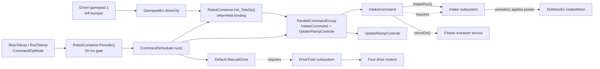
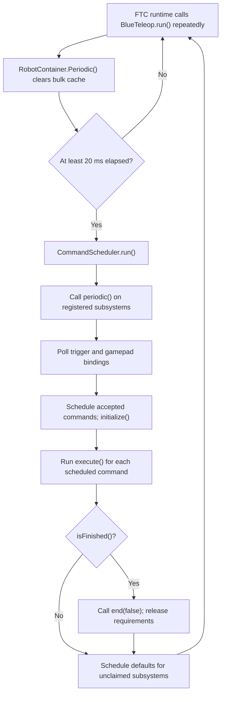

# Teaching FTCLib's Command-Based Programming Model

This lesson is based on the BioBuzz codebase and FTCLib 2.1.1. It is designed for high-school students who know some Java and FTC robotics but are still learning about software architecture, event loops, and object-oriented design.

## 1. Codebase findings

The project uses FTCLib `core:2.1.1` and FTC SDK 12.0.0 dependencies, declared in [`TeamCode/build.gradle`](../TeamCode/build.gradle). The TeleOp OpModes extend `CommandOpMode`, but the robot container calls `CommandScheduler.run()` itself.

| Relative path and class | Architectural role | Why it matters |
|---|---|---|
| [`TeamCode/build.gradle`](../TeamCode/build.gradle) | Dependency declaration | Identifies the FTCLib version as 2.1.1. |
| [`TeamCode/src/main/java/org/firstinspires/ftc/teamcode/OpModes/TeleOp/BlueTeleop.java`](../TeamCode/src/main/java/org/firstinspires/ftc/teamcode/OpModes/TeleOp/BlueTeleop.java) — `BlueTeleop.initialize()` / `run()` | TeleOp entry point | Initializes the robot container, then repeatedly calls its periodic loop. `RedTeleop` follows the same pattern. |
| [`TeamCode/src/main/java/org/firstinspires/ftc/teamcode/RobotContainer.java`](../TeamCode/src/main/java/org/firstinspires/ftc/teamcode/RobotContainer.java) — `Init()`, `Init_TeleOp()`, `Periodic()` | Robot setup and control coordination | Creates gamepad and subsystem objects, configures button bindings and the drivetrain default command, and calls the scheduler. |
| [`TeamCode/src/main/java/org/firstinspires/ftc/teamcode/Commands/Drive/ManualDrive.java`](../TeamCode/src/main/java/org/firstinspires/ftc/teamcode/Commands/Drive/ManualDrive.java) — `initialize()`, `execute()`, `isFinished()` | Default drive command | Requires the drivetrain, repeatedly reads joystick input, and runs until displaced or the OpMode ends. |
| [`TeamCode/src/main/java/org/firstinspires/ftc/teamcode/Subsystems/DriveTrain.java`](../TeamCode/src/main/java/org/firstinspires/ftc/teamcode/Subsystems/DriveTrain.java) — `periodic()`, `FieldDrive()`, `RobotDrive()` | Drivetrain hardware and control | Reads drive-motor velocities, computes control outputs, and applies motor power. |
| [`TeamCode/src/main/java/org/firstinspires/ftc/teamcode/Commands/Intake/IntakeCommand.java`](../TeamCode/src/main/java/org/firstinspires/ftc/teamcode/Commands/Intake/IntakeCommand.java) — `execute()`, `end()` | Intake task | Requires the intake, starts it while scheduled, and asks it to stop on completion or interruption. |
| [`TeamCode/src/main/java/org/firstinspires/ftc/teamcode/Subsystems/Intake/Intake.java`](../TeamCode/src/main/java/org/firstinspires/ftc/teamcode/Subsystems/Intake/Intake.java) — `periodic()`, `intakeRun()`, `intakeStop()` | Intake hardware and control | Owns the intake motor and extractor servos. Its `periodic()` method applies motor control. |
| [`TeamCode/src/main/java/org/firstinspires/ftc/teamcode/Commands/UptakeRampControle.java`](../TeamCode/src/main/java/org/firstinspires/ftc/teamcode/Commands/UptakeRampControle.java) — `initialize()`, `isFinished()`, `end()` | Ramp task | Raises the ramp, waits for an artifact or configured timeout, then lowers the ramp. |
| [`TeamCode/src/main/java/org/firstinspires/ftc/teamcode/CommandGroups/TeleOpSequences/IntakeSequence.java`](../TeamCode/src/main/java/org/firstinspires/ftc/teamcode/CommandGroups/TeleOpSequences/IntakeSequence.java) — constructor and `end()` | Composed intake sequence | Demonstrates command composition, requirements, and cleanup. |
| [`TeamCode/src/main/java/org/firstinspires/ftc/teamcode/CommandGroups/TeleOpSequences/ShotSequence.java`](../TeamCode/src/main/java/org/firstinspires/ftc/teamcode/CommandGroups/TeleOpSequences/ShotSequence.java) — constructor and `end()` | Composed shooting sequence | Demonstrates a sequential, sensor-driven command group and its cleanup. |

**Concepts not directly represented:** The project does not define a separate robot-wide event-loop framework; its `RobotContainer.Periodic()` is the loop wrapper. It demonstrates requirements, defaults, triggers, and parallel/sequential groups. It does not have a small isolated example written specifically to teach conflict resolution; the conflict demonstration below uses two existing intake bindings.

## 2. Instructor's mental model

Think of the scheduler as a **stage manager**. Subsystems are the stage's equipment teams—drive, intake, shooter—and commands are the tasks that ask those teams to do something. A command declares which subsystem it needs so the scheduler does not assign two incompatible tasks to the same equipment at once.

The analogy has limits: commands are Java objects, the scheduler is a library, and subsystem requirements are an explicit software coordination mechanism—not people negotiating backstage.

### The real control flow

The project's concrete example is the driver **holding the left bumper**:

1. `RobotContainer.Init_TeleOp()` binds the driver's left bumper to a `ParallelCommandGroup` containing `IntakeCommand` and `UptakeRampControle`.
2. The FTC runtime repeatedly calls `BlueTeleop.run()`. That calls `RobotContainer.Periodic()`.
3. About every 20 ms, `RobotContainer.Periodic()` calls `CommandScheduler.getInstance().run()`.
4. In FTCLib 2.1.1, the scheduler calls registered subsystem `periodic()` methods, polls bindings, runs scheduled commands' `execute()` methods, and checks their `isFinished()` results.
5. `IntakeCommand.execute()` calls `Intake.intakeRun()`. That sets the target speed and turns on the extractor servos.
6. `Intake.periodic()` reads the motor velocity and applies motor power toward the target.

The FTCLib 2.1.1 scheduler cycle is **subsystem periodic → binding poll → command execute → `isFinished()` check → defaults for unclaimed subsystems**. When the held binding schedules a command during the binding poll, its `initialize()` runs as it is scheduled, before its first `execute()`.

### Lifecycle and requirements

- **Construction** creates a command object. It is not necessarily scheduled yet.
- **`initialize()`** runs once when a command starts. It is not the constructor.
- **`execute()`** runs repeatedly on scheduler cycles while the command remains scheduled.
- **`isFinished()`** is checked repeatedly after execution. Returning `true` ends the command normally.
- **`end(false)`** means normal completion; **`end(true)`** means interruption or cancellation.
- A command's **requirement** reserves a subsystem; it does not itself call any subsystem method.
- If a new command needs a subsystem held by an interruptible command, the scheduler interrupts the current command—calling `end(true)`—and schedules the new one. If the current command is not interruptible, the new command may be rejected.

Commands do not run on separate threads just because they are scheduled. This code processes them through repeated calls to the scheduler.

### Defaults and subsystem registration

`DriveTrain` extends FTCLib's `SubsystemBase`. In FTCLib 2.1.1, `SubsystemBase` registers itself with the scheduler when constructed. `RobotContainer.Init_TeleOp()` sets `ManualDrive` as the drivetrain's default command. A default is scheduled when its subsystem is free; it must require that subsystem and normally should not finish. When another command takes over the drivetrain, the default is interrupted; once the drivetrain becomes free, the scheduler schedules the default again.

### `periodic()` versus `execute()`

| Method | Belongs to | Called by | Intended role |
|---|---|---|---|
| `periodic()` | A subsystem | Scheduler, once per scheduler cycle for registered subsystems | Update or monitor subsystem state; apply subsystem-level control |
| `execute()` | A command | Scheduler, repeatedly while the command is scheduled | Perform the work of that command |

Subsystem `periodic()` is called even when no command is using that subsystem. `execute()` is not. Both can run during one scheduler cycle: subsystem periodic runs first, then scheduled commands execute.

For the intake example, `Intake.periodic()` runs **before** `IntakeCommand.execute()` sets the new intake target in that cycle. The next scheduler cycle's `periodic()` sees the target and calculates motor power. On release, `IntakeCommand.end()` calls `intakeStop()`; the subsystem's next `periodic()` processes the zero target.

**Project-specific wrinkle:** `DriveTrain.RobotDrive()` also calls `periodic()` directly. That means `DriveTrain.periodic()` is not only invoked by the scheduler; it can also run immediately when `RobotDrive()` is called. Explain this as a project-specific design choice, not general FTCLib behavior.

**Rule of thumb:** `periodic()` maintains a subsystem; `execute()` carries out a scheduled command.

### Project-specific caveats

- `RobotContainer.Periodic()` uses a 20 ms timer gate, so the scheduler and subsystem periodic methods run at about 50 Hz, not on every raw FTC loop iteration.
- The OpMode subclasses extend `CommandOpMode`, but override its `run()` method to call `RobotContainer.Periodic()`, which in turn calls the scheduler. This is the project's scheduler path.
- `BlueTeleop.initialize()` calls `waitForStart()`, even though FTCLib's `CommandOpMode.runOpMode()` calls `waitForStart()` after `initialize()` returns. This is unusual and worth reviewing separately; it is not needed to explain command lifecycle.
- FTCLib's `CommandOpMode` resets the scheduler after its main loop. Do not promise students that this necessarily calls `end()` on every active command. The project's commands should clean up on interruption, and hardware safety on OpMode stop should be verified on the robot.

## 3. Slide-by-slide presentation outline

### Slide 1 — The problem command-based programming solves

- A robot has multiple mechanisms.
- Driver inputs and sensor events arrive repeatedly.
- Separate actions can conflict.
- We need a predictable way to coordinate work.

**Visual:** Driver inputs feeding a robot with labeled mechanisms.  
**Speaker notes:** Without a structure, input checks, motor control, and cleanup can become tangled in one large loop.  
**Show:** [`RobotContainer.java`](../TeamCode/src/main/java/org/firstinspires/ftc/teamcode/RobotContainer.java).  
**Ask:** “What could go wrong if two parts of the program both try to control the intake?”

### Slide 2 — The whole-system mental model

- Input or robot condition
- Trigger or binding
- Scheduler
- Command lifecycle
- Subsystem method
- Hardware action

**Visual:** The six-step flow with the left bumper example.  
**Speaker notes:** Keep this as the lesson's recurring map.  
**Show:** [`RobotContainer.java`](../TeamCode/src/main/java/org/firstinspires/ftc/teamcode/RobotContainer.java).  
**Ask:** “Where in this chain does a button become a running command?”

### Slide 3 — The repeated robot loop

- FTC repeatedly calls the OpMode loop.
- The project gates scheduler runs to about 20 ms.
- The scheduler updates subsystems and commands.
- The process repeats while the OpMode is active.

**Visual:** A loop with a 20 ms gate.  
**Speaker notes:** “50 Hz” means about 50 scheduler cycles per second, not a new thread.  
**Show:** [`BlueTeleop.java`](../TeamCode/src/main/java/org/firstinspires/ftc/teamcode/OpModes/TeleOp/BlueTeleop.java) and [`RobotContainer.java`](../TeamCode/src/main/java/org/firstinspires/ftc/teamcode/RobotContainer.java).  
**Ask:** “If the robot checks a command 50 times a second, is that the same as 50 threads?”

### Slide 4 — Subsystems: the robot's mechanism owners

- A subsystem represents a mechanism or functional unit.
- It owns hardware references.
- It can have a `periodic()` method.
- FTCLib registers `SubsystemBase` instances automatically.

**Visual:** `Intake` connected to motor and servos.  
**Speaker notes:** A subsystem offers methods such as `intakeRun()`; the command chooses when to call them.  
**Show:** [`Intake.java`](../TeamCode/src/main/java/org/firstinspires/ftc/teamcode/Subsystems/Intake/Intake.java).  
**Ask:** “Which class should know the intake motor's hardware-map name?”

### Slide 5 — Commands: robot tasks

- A command describes an action.
- It declares subsystem requirements.
- It may finish on a sensor, timer, or other condition.
- A command object can exist without being scheduled.

**Visual:** `IntakeCommand` card with its `Intake` requirement.  
**Speaker notes:** A requirement reserves a subsystem; it is separate from calling a method on that subsystem.  
**Show:** [`IntakeCommand.java`](../TeamCode/src/main/java/org/firstinspires/ftc/teamcode/Commands/Intake/IntakeCommand.java).  
**Ask:** “Does adding an intake requirement start the motor?”

### Slide 6 — The command lifecycle

- `initialize()` runs once at start.
- `execute()` repeats while scheduled.
- `isFinished()` is checked repeatedly.
- `end(false)` is normal completion; `end(true)` is interruption.

**Visual:** Command lifecycle diagram.  
**Speaker notes:** The constructor configures the object; `initialize()` begins a scheduled run.  
**Show:** [`IntakeCommand.java`](../TeamCode/src/main/java/org/firstinspires/ftc/teamcode/Commands/Intake/IntakeCommand.java).  
**Ask:** “When the driver releases the button, which `end` value should we expect?”

### Slide 7 — The scheduler: coordinator, not a thread manager

- Polls triggers.
- Runs scheduled commands.
- Checks completion.
- Resolves requirement conflicts.
- Schedules defaults for free subsystems.

**Visual:** Scheduler connecting input, commands, and subsystems.  
**Speaker notes:** It coordinates repeated work in the OpMode loop; it does not create a worker thread for each command.  
**Show:** [`RobotContainer.java`](../TeamCode/src/main/java/org/firstinspires/ftc/teamcode/RobotContainer.java).  
**Ask:** “What should happen if a new command needs an already-used subsystem?”

### Slide 8 — `periodic()` versus `execute()`

- `periodic()` belongs to a subsystem.
- `execute()` belongs to a command.
- Scheduler calls subsystem periodic methods before commands.
- Both can run in one scheduler cycle.

**Visual:** Two rows on a timeline: subsystem first, command second.  
**Speaker notes:** The intake periodic control sees target changes made by the command on the following cycle.  
**Show:** [`Intake.java`](../TeamCode/src/main/java/org/firstinspires/ftc/teamcode/Subsystems/Intake/Intake.java) and [`IntakeCommand.java`](../TeamCode/src/main/java/org/firstinspires/ftc/teamcode/Commands/Intake/IntakeCommand.java).  
**Ask:** “Does `Intake.periodic()` stop running when no intake command is scheduled?”

### Slide 9 — Requirements and conflicts

- Commands declare what they need.
- One subsystem cannot be owned by two scheduled commands at once.
- A new interruptible command can interrupt the old one.
- The old command gets `end(true)`.

**Visual:** Two commands competing for the intake.  
**Speaker notes:** Compare `IntakeCommand` and `ReverseIntakeCommand`; both require the intake.  
**Show:** [`IntakeCommand.java`](../TeamCode/src/main/java/org/firstinspires/ftc/teamcode/Commands/Intake/IntakeCommand.java) and [`ReverseIntakeCommand.java`](../TeamCode/src/main/java/org/firstinspires/ftc/teamcode/Commands/Intake/ReverseIntakeCommand.java).  
**Ask:** “Which command should control the intake if both bindings become active?”

### Slide 10 — Default commands

- A default fills in when a subsystem is free.
- `ManualDrive` is the drivetrain default.
- A command that takes the drivetrain interrupts it.
- When the drivetrain is free again, the default is scheduled.

**Visual:** `ManualDrive` entering an empty drivetrain slot, then yielding to another command.  
**Speaker notes:** The default command still needs the subsystem and should not finish on its own.  
**Show:** [`RobotContainer.java`](../TeamCode/src/main/java/org/firstinspires/ftc/teamcode/RobotContainer.java) and [`ManualDrive.java`](../TeamCode/src/main/java/org/firstinspires/ftc/teamcode/Commands/Drive/ManualDrive.java).  
**Ask:** “What should happen to manual driving when a command takes over the drivetrain?”

### Slide 11 — Controller bindings and triggers

- Bindings translate button state into scheduling.
- `whenHeld` runs while the button is held.
- `whenPressed` starts on a press.
- A trigger can represent an analog threshold.

**Visual:** Left bumper and left trigger leading to different intake commands.  
**Speaker notes:** A binding is not itself the command's work; it tells the scheduler when to schedule or cancel the command.  
**Show:** [`RobotContainer.java`](../TeamCode/src/main/java/org/firstinspires/ftc/teamcode/RobotContainer.java).  
**Ask:** “What is different about a trigger based on `left_trigger > 0.5`?”

### Slide 12 — A complete trace: left bumper to intake

- Left bumper binding schedules a parallel group.
- The group contains intake and ramp commands.
- `IntakeCommand` requires `Intake`.
- The subsystem controls motor power and servos.

**Visual:** Trace the full path with arrows.  
**Speaker notes:** The command sets a target; subsystem periodic applies motor control.  
**Show:** [`RobotContainer.java`](../TeamCode/src/main/java/org/firstinspires/ftc/teamcode/RobotContainer.java), [`IntakeCommand.java`](../TeamCode/src/main/java/org/firstinspires/ftc/teamcode/Commands/Intake/IntakeCommand.java), and [`Intake.java`](../TeamCode/src/main/java/org/firstinspires/ftc/teamcode/Subsystems/Intake/Intake.java).  
**Ask:** “Which method actually calls `setPower()` for the intake motor?”

### Slide 13 — Common mistakes

- Treating `initialize()` as the constructor.
- Forgetting a requirement.
- Putting one-time work in `execute()`.
- Forgetting safe cleanup in `end()`.
- Assuming commands run in parallel threads.

**Visual:** A “myth / actual behavior” split.  
**Speaker notes:** `IntakeCommand` is a useful positive example: it declares its requirement and stops on end.  
**Show:** [`IntakeCommand.java`](../TeamCode/src/main/java/org/firstinspires/ftc/teamcode/Commands/Intake/IntakeCommand.java).  
**Ask:** “What bug could happen if two commands use the same subsystem but only one declares it?”

### Slide 14 — Student prediction exercise

- Hold left bumper.
- Then activate the left trigger.
- Predict which intake command remains scheduled.
- Predict what happens when the trigger is released.

**Visual:** Two command cards competing for `Intake`.  
**Speaker notes:** Both commands require intake. Use a secured robot or work through the code without activating hardware.  
**Show:** [`RobotContainer.java`](../TeamCode/src/main/java/org/firstinspires/ftc/teamcode/RobotContainer.java).  
**Ask:** “Which command's `end()` method runs when the second command takes over?”

### Slide 15 — Summary and knowledge check

- Input triggers scheduling.
- Scheduler runs commands and subsystem updates.
- Requirements coordinate access.
- Lifecycle methods define start, repeated work, and cleanup.
- The loop repeats until the OpMode stops.

**Visual:** The complete mental model as a single flow.  
**Speaker notes:** Recap framework behavior versus project-specific behavior.  
**Show:** [`BlueTeleop.java`](../TeamCode/src/main/java/org/firstinspires/ftc/teamcode/OpModes/TeleOp/BlueTeleop.java).  
**Ask:** “Can someone describe the left-bumper-to-motor path in one sentence?”

## 4. Visual diagrams

### Component diagram



### Sequence: left bumper to hardware output

```mermaid
sequenceDiagram
    actor Driver
    participant OpMode as BlueTeleop
    participant RC as RobotContainer
    participant Scheduler as CommandScheduler
    participant Binding as LeftBumperBinding
    participant Group as IntakeParallelGroup
    participant IntakeCmd as IntakeCommand
    participant Intake as Intake
    participant Motor as intakeMotor
    participant Servos as FlowerExtractorServos

    loop Each active scheduler pass, gated to about 20 ms
        OpMode->>RC: Periodic()
        RC->>Scheduler: run()
        Scheduler->>Intake: periodic() before commands
        Scheduler->>Binding: poll gamepad1 left bumper
        Driver->>Binding: hold left bumper
        Binding->>Scheduler: schedule ParallelCommandGroup
        Scheduler->>Group: initialize child commands
        Scheduler->>Group: execute()
        Group->>IntakeCmd: execute()
        IntakeCmd->>Intake: intakeRun() sets target to 50 RPS
        Intake->>Servos: servoOn()
    end
    opt Next scheduler pass
        Scheduler->>Intake: periodic() reads velocity and computes PIF power
        Intake->>Motor: setPower(CurrentPower)
    end
    Driver->>Binding: release left bumper
    Scheduler->>Binding: poll inactive; cancel group
    Group->>IntakeCmd: end(true)
    IntakeCmd->>Intake: intakeStop() sets target to zero
    Intake->>Servos: servoOff()
```

### Command lifecycle

```mermaid
stateDiagram-v2
    [*] --> NotScheduled
    NotScheduled --> Scheduled: schedule accepted and requirements available
    Scheduled --> Running: initialize() once
    Running --> Running: execute(); isFinished() is false
    Running --> Finished: isFinished() is true
    Finished --> NotScheduled: end(false); release requirements
    Running --> Interrupted: cancel or conflict
    Interrupted --> NotScheduled: end(true); release requirements
```



### Scheduler cycle



The cycle diagram shows the usual path; on a conflict, the scheduler can interrupt a command during scheduling, which calls `end(true)`.

## 5. Interactive VS Code demonstration

Use a robot that is secured and safe to operate. Keep hands, hair, and loose objects away from the intake and drivetrain.

### Demonstration 1: follow the left bumper to the hardware

1. **Start at the OpMode**
   - Open [`BlueTeleop.java`](../TeamCode/src/main/java/org/firstinspires/ftc/teamcode/OpModes/TeleOp/BlueTeleop.java).
   - Highlight `initialize()` and `run()`.
   - Explain that `run()` delegates to `RobotContainer.Periodic()`.
   - **Predict:** “Where will we find the actual scheduler call?”
   - **Observe:** Follow the method call to the container.

2. **Find the loop gate and scheduler**
   - Open [`RobotContainer.java`](../TeamCode/src/main/java/org/firstinspires/ftc/teamcode/RobotContainer.java).
   - Highlight `Periodic()`, the 20 ms check, and `CommandScheduler.getInstance().run()`.
   - Explain that scheduler cycles are gated to about 50 Hz.
   - **Predict:** “Does every raw OpMode loop necessarily run subsystem periodic methods?”
   - **Observe:** No; only scheduler calls do.

3. **Find the button binding**
   - In `Init_TeleOp()`, highlight the left-bumper `whenHeld` binding.
   - Explain that it constructs a parallel group from `IntakeCommand` and `UptakeRampControle`.
   - **Predict:** “Does constructing those command objects mean they are already running?”
   - **Observe:** No. They are scheduled when the binding becomes active.

4. **Inspect the command requirement**
   - Open [`IntakeCommand.java`](../TeamCode/src/main/java/org/firstinspires/ftc/teamcode/Commands/Intake/IntakeCommand.java).
   - Highlight its constructor, `execute()`, `isFinished()`, and `end()`.
   - Explain `addRequirements(RobotContainer.intake)`.
   - **Predict:** “What happens when the driver releases the bumper?”
   - **Observe:** The held command is canceled; `end(true)` stops the intake.

5. **Follow the subsystem call to hardware**
   - Open [`Intake.java`](../TeamCode/src/main/java/org/firstinspires/ftc/teamcode/Subsystems/Intake/Intake.java).
   - Highlight `intakeRun()`, `periodic()`, motor `setPower()`, and `servoOn()`.
   - Explain the target-speed versus applied-power distinction.
   - **Predict:** “Which method calls `setPower()` for the intake motor?”
   - **Observe:** `periodic()` applies the motor controller output; `intakeRun()` sets its target and starts the servos.
   - **Fallback:** Walk the trace in the editor without connecting hardware. Students can mark the call sequence and identify the motor API call.

### Demonstration 2: requirement conflict

- In `RobotContainer.Init_TeleOp()`, compare the left-bumper binding with the left-trigger binding.
- Open [`ReverseIntakeCommand.java`](../TeamCode/src/main/java/org/firstinspires/ftc/teamcode/Commands/Intake/ReverseIntakeCommand.java) and show that it also requires `Intake`.
- **Predict:** “If left bumper is held and the left-trigger threshold is crossed, which command can own the intake?”
- **Action:** Prefer a code walkthrough or debugger breakpoints. If demonstrating on a robot, secure the mechanism and keep the intake clear.
- **Observe:** The new intake command conflicts with the active intake command/group; the prior command is interrupted and its cleanup runs.
- **Fallback:** Draw the requirement ownership on the whiteboard. No temporary code change is needed.

## 6. `periodic()` versus `execute()`—deeper explanation

| Question | Subsystem `periodic()` | Command `execute()` |
|---|---|---|
| Who owns it? | A subsystem such as `Intake` or `DriveTrain` | A command such as `IntakeCommand` or `ManualDrive` |
| Who calls it? | FTCLib scheduler | FTCLib scheduler |
| When? | Once per scheduler cycle for each registered subsystem | Repeatedly while the command is scheduled |
| Runs with no active command? | Yes | No |
| Typical work | Update measurements, maintain subsystem-level control | Read inputs and request the action for this command |
| Project example | `Intake.periodic()` computes and applies motor power | `IntakeCommand.execute()` calls `intakeRun()` |

The two methods can run in the same scheduler cycle. In FTCLib 2.1.1, subsystem `periodic()` comes first. So when `IntakeCommand.execute()` changes the target speed, `Intake.periodic()` uses that new target on the next scheduler cycle.

**Rule of thumb:** `periodic()` maintains the subsystem; `execute()` performs the scheduled task.

## 7. Code tracing exercise

**Starting input:** Driver holds gamepad 1's left bumper.

**Inspect these files:**

- [`RobotContainer.java`](../TeamCode/src/main/java/org/firstinspires/ftc/teamcode/RobotContainer.java)
- [`IntakeCommand.java`](../TeamCode/src/main/java/org/firstinspires/ftc/teamcode/Commands/Intake/IntakeCommand.java)
- [`UptakeRampControle.java`](../TeamCode/src/main/java/org/firstinspires/ftc/teamcode/Commands/UptakeRampControle.java)
- [`Intake.java`](../TeamCode/src/main/java/org/firstinspires/ftc/teamcode/Subsystems/Intake/Intake.java)

### Student worksheet — no answers

1. Which method creates the left-bumper binding?
2. Which command objects are placed in its parallel group?
3. Which subsystem does `IntakeCommand` require?
4. Which method calls `intakeRun()`?
5. Does `intakeRun()` directly set motor power?
6. Which subsystem method applies the intake motor power?
7. What calls `IntakeCommand.end()` when the driver releases the bumper?
8. Explain the complete path from button press to hardware behavior in your own words.

### Instructor answer key

1. `RobotContainer.Init_TeleOp()`.
2. `IntakeCommand` and `UptakeRampControle`.
3. `RobotContainer.intake`.
4. `IntakeCommand.execute()`.
5. No. It sets target speed and starts the extractor servos.
6. `Intake.periodic()`.
7. The held binding cancels the active command/group when the button becomes inactive; the command ends interrupted.
8. The binding schedules the command group; the scheduler runs its commands; `IntakeCommand.execute()` sets the intake target and starts the servos; `Intake.periodic()` applies motor power toward that target. On release, cleanup sets the target to zero and turns the servos off.

**Expected behavior:** Intake roller and extractor servos run while the command is active. When it ends, the command requests stop; the subsystem applies the updated target on its periodic update.

## 8. Prediction exercises

### A. A new command requires the active command's subsystem

- **Scenario:** `IntakeCommand` is active; a reverse-intake command requiring `Intake` is scheduled.
- **Question:** Can both own the intake simultaneously?
- **Answer:** No. The new command can interrupt the existing interruptible command.
- **Reasoning:** Requirements are exclusive scheduler ownership.
- **Relevant code:** [`IntakeCommand.java`](../TeamCode/src/main/java/org/firstinspires/ftc/teamcode/Commands/Intake/IntakeCommand.java) and [`ReverseIntakeCommand.java`](../TeamCode/src/main/java/org/firstinspires/ftc/teamcode/Commands/Intake/ReverseIntakeCommand.java).

### B. `isFinished()` changes from false to true

- **Scenario:** `WaitForSpinup.isFinished()` becomes true because the flywheel reaches target speed or times out.
- **Question:** What happens next?
- **Answer:** The scheduler calls `end(false)`, releases its requirements, and the enclosing sequence can advance.
- **Reasoning:** Completion is checked repeatedly after execution.
- **Relevant code:** [`WaitForSpinup.java`](../TeamCode/src/main/java/org/firstinspires/ftc/teamcode/Commands/Shoot/WaitForSpinup.java) and [`ShotSequence.java`](../TeamCode/src/main/java/org/firstinspires/ftc/teamcode/CommandGroups/TeleOpSequences/ShotSequence.java).

### C. The left bumper is released

- **Scenario:** The intake parallel group is active and the driver releases the bumper.
- **Question:** Is the intake command's end normal or interrupted?
- **Answer:** Interrupted; the held binding cancels the active command/group.
- **Reasoning:** The command did not finish through its own `isFinished()` result.
- **Relevant code:** [`RobotContainer.java`](../TeamCode/src/main/java/org/firstinspires/ftc/teamcode/RobotContainer.java) and [`IntakeCommand.java`](../TeamCode/src/main/java/org/firstinspires/ftc/teamcode/Commands/Intake/IntakeCommand.java).

### D. The drivetrain becomes free

- **Scenario:** A command that required the drivetrain ends.
- **Question:** What happens to `ManualDrive`?
- **Answer:** It is scheduled as the drivetrain default when the scheduler checks defaults.
- **Reasoning:** The default is assigned to `DriveTrain` and requires it.
- **Relevant code:** [`RobotContainer.java`](../TeamCode/src/main/java/org/firstinspires/ftc/teamcode/RobotContainer.java) and [`ManualDrive.java`](../TeamCode/src/main/java/org/firstinspires/ftc/teamcode/Commands/Drive/ManualDrive.java).

### E. The OpMode stops while a command is active

- **Scenario:** The robot exits the OpMode loop with a command still scheduled.
- **Question:** Should students assume the command's `end()` cleanup is called?
- **Answer:** No. Do not assume it; FTCLib's `CommandOpMode` resets the scheduler after the loop rather than guaranteeing every command gets its cleanup callback.
- **Reasoning:** Hardware safety should be verified separately and cleanup should be explicit where needed.
- **Relevant code:** [`BlueTeleop.java`](../TeamCode/src/main/java/org/firstinspires/ftc/teamcode/OpModes/TeleOp/BlueTeleop.java); framework behavior verified against the cached FTCLib 2.1.1 source.

## 9. Common mistakes and troubleshooting

| Mistake | Relevant here? | Teaching point |
|---|---|---|
| Forgetting to register a subsystem | Less likely here: `SubsystemBase` auto-registers in FTCLib 2.1.1 | A plain custom `Subsystem` may need registration; this project's subclasses use `SubsystemBase`. |
| Forgetting command requirements | Relevant to review in every new command | Without requirements, scheduler conflict protection cannot work. |
| Putting one-time setup in `execute()` | A general risk | `execute()` repeats; use `initialize()` for one-time command startup. |
| Hardware side effects in constructors | Relevant as a design concern | Subsystem constructors here map and configure hardware; commands should avoid starting actions merely because an object was constructed. |
| Returning `true` too early from `isFinished()` | General risk | The command will end as soon as the scheduler checks it after execution. |
| A command never finishes | Intentional for `ManualDrive` and `IntakeCommand` while held | Continuous commands should be canceled by bindings or interrupted by requirements. |
| Confusing bindings with command execution | Relevant | A binding schedules/cancels; the command contains the action. |
| Assuming commands use separate threads | General misconception | Scheduler processes commands in its loop. |
| Failing to stop hardware in `end()` | Relevant for review | `IntakeCommand` and `ShotSequence` clean up; `ManualDrive.end()` is empty, so review safe behavior when its drivetrain ownership ends. |
| Not calling `CommandScheduler.run()` | Not the current pattern | This project calls it from `RobotContainer.Periodic()`, called by the TeleOp `run()` method. |
| Assuming stop always calls `end()` | Relevant shutdown caveat | Verify stop behavior and use appropriate explicit safety cleanup. |
| Treating direct calls to `periodic()` as scheduler callbacks | Relevant for `DriveTrain` | `RobotDrive()` calls `periodic()` directly as well as scheduler cycles. |

## 10. Knowledge check and takeaway

### Five questions

1. Which class owns `periodic()`?
2. What does a command requirement tell the scheduler?
3. How does `initialize()` differ from a constructor?
4. What is the difference between `end(false)` and `end(true)`?
5. In the intake example, which method applies motor power?

**Answer key:**

1. A subsystem.
2. Which subsystem the command needs to reserve.
3. The constructor creates/configures the object; `initialize()` runs when the scheduled command starts.
4. Normal completion versus interruption/cancellation.
5. `Intake.periodic()`.

### One-minute student summary

“The driver input activates a binding, and the binding asks the scheduler to schedule a command. The command declares which subsystem it needs, then the scheduler calls `initialize()` once, `execute()` repeatedly, and checks `isFinished()` repeatedly. The subsystem's `periodic()` method runs each scheduler cycle to maintain or update its mechanism. When a command finishes or is interrupted, `end()` performs cleanup. The scheduler repeats this work through the robot's control loop.”

### Three follow-up coding activities

1. **Easiest:** Add telemetry that reports whether an existing command or sensor condition is active.
2. **Intermediate:** Write a timed command that uses `initialize()`, repeated `execute()`, `isFinished()`, and cleanup in `end()`.
3. **Most challenging:** Compose a sequential autonomous routine from existing commands, declare its requirements, and test its interruption and cleanup behavior.
