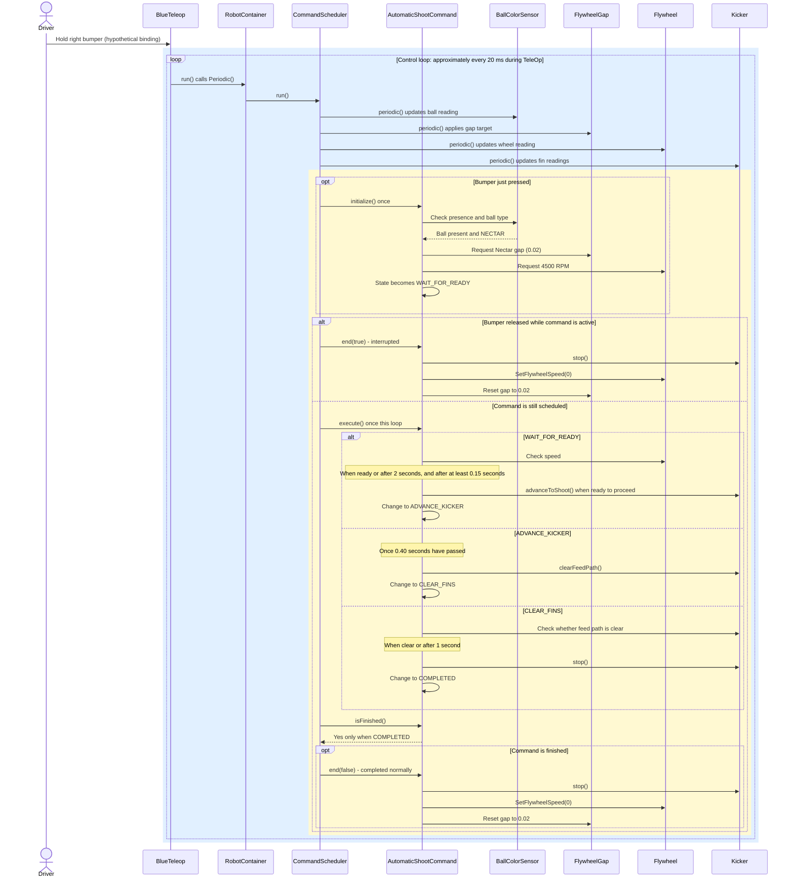
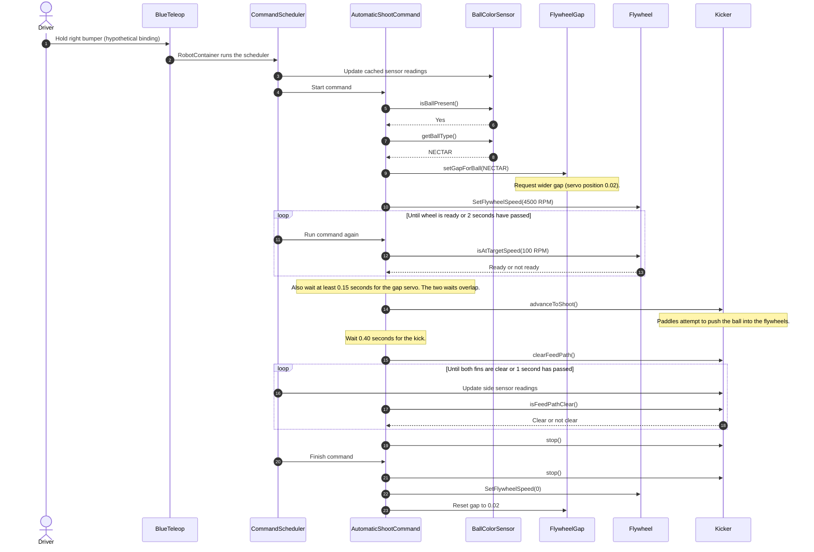
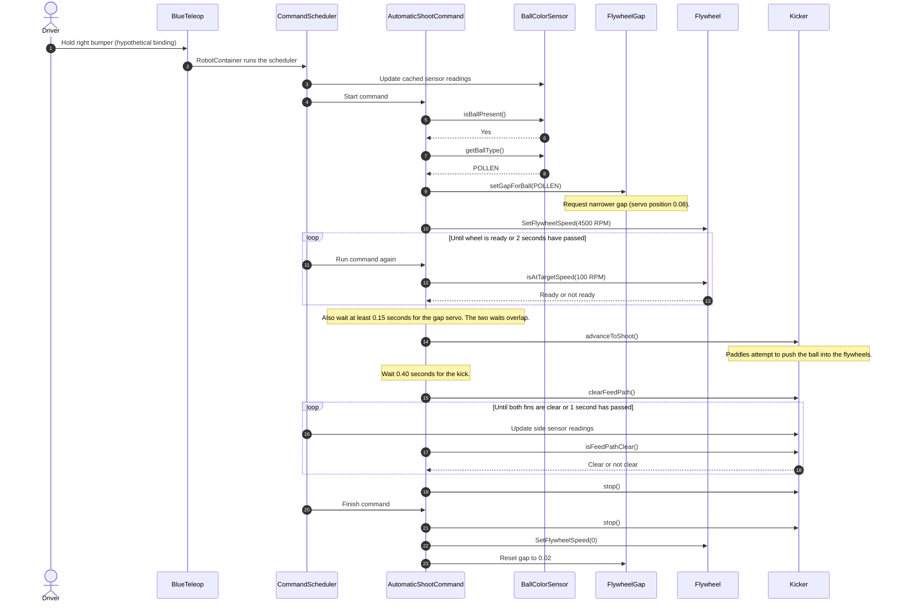
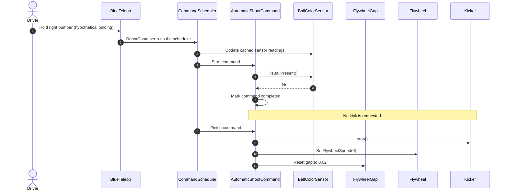

# Blue TeleOp shooting: three scenarios

These diagrams explain what `AutomaticShootCommand` would do if Blue TeleOp's
right bumper were connected to it. **That connection is hypothetical**: the
current right bumper runs `ShotSequence` instead. No robot code is changed by
these diagrams.

Read each diagram from top to bottom. An arrow shows one part of the program
asking another part to do something or returning an answer.

- **CommandScheduler** starts commands and runs them repeatedly.
- **AutomaticShootCommand** decides when to check, wait, kick, and stop.
- **Subsystems** control or read parts of the robot: the ball sensor, flywheel
  gap servo, flywheel motors, and kicker paddles.
- **RPM** means revolutions per minute, a measure of how fast a wheel spins.

The examples use the command's default settings and assume the driver keeps
holding the button until the command finishes.

## Command lifecycle: Nectar inside the control loop

The blue box is the **control loop**: the robot repeats it approximately every
20 milliseconds throughout TeleOp, even after the command finishes. The yellow
box shows the Nectar shooting work inside that loop. Each pass through the loop
runs only the command's current state, not all three states at once.

`initialize()` runs once when scheduled. `execute()` and `isFinished()` run on
each scheduler pass while the command remains active. `end()` runs once when
the command finishes or is interrupted. The detailed Nectar diagram below
shows the same shot without the surrounding lifecycle.

## 1. Nectar ball

## 2. Pollen ball

## 3. No ball detected

## Things to know

- The sensor stores its latest reading for the command to use. If it detects
  a ball but cannot identify its type, the command uses the wider Nectar gap.
- The command can kick after the 2-second timeout even if the wheel is not
  ready. A clear feed path means both cached side-sensor distances are at least
  60 mm; a timeout also ends the wait.
- The current flywheel code calculates motor power but does **not** apply it
  during TeleOp. These diagrams show the requested actions, not a guarantee
  that a ball is launched. Other periodic robot code can also change the
  requested speed and gap.
- With the hypothetical `whenHeld` binding, releasing the bumper early
  interrupts the command and runs its stop/reset actions. Keeping it held after
  completion does not start another shot.

## Source

- [BlueTeleop](../TeamCode/src/main/java/org/firstinspires/ftc/teamcode/OpModes/TeleOp/BlueTeleop.java),
  [RobotContainer](../TeamCode/src/main/java/org/firstinspires/ftc/teamcode/RobotContainer.java)
- [AutomaticShootCommand](../TeamCode/src/main/java/org/firstinspires/ftc/teamcode/Commands/Shoot/AutomaticShootCommand.java)
- [BallColorSensor](../TeamCode/src/main/java/org/firstinspires/ftc/teamcode/Subsystems/Sensors/BallColorSensor.java),
  [FlywheelGap](../TeamCode/src/main/java/org/firstinspires/ftc/teamcode/Subsystems/Shooter/FlywheelGap.java),
  [Flywheel](../TeamCode/src/main/java/org/firstinspires/ftc/teamcode/Subsystems/Shooter/Flywheel.java),
  [Kicker](../TeamCode/src/main/java/org/firstinspires/ftc/teamcode/Subsystems/Shooter/Kicker.java)
